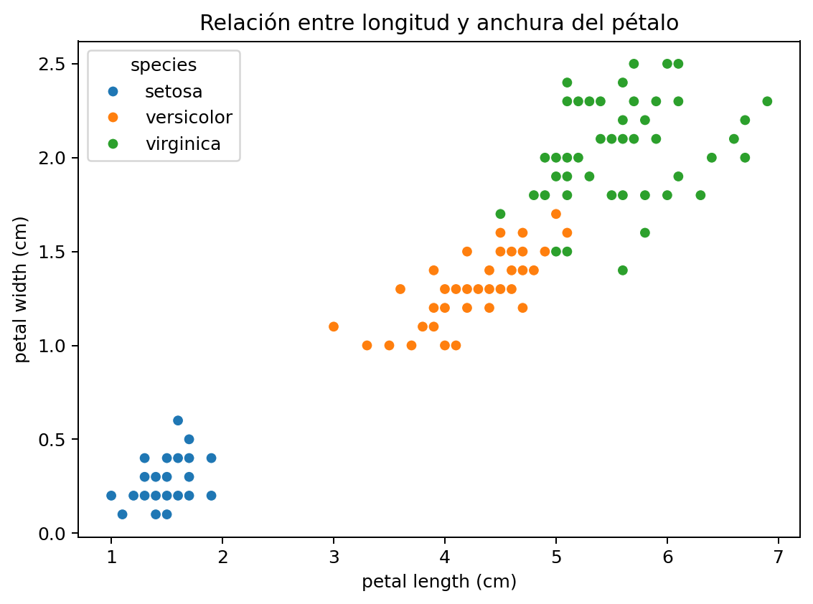
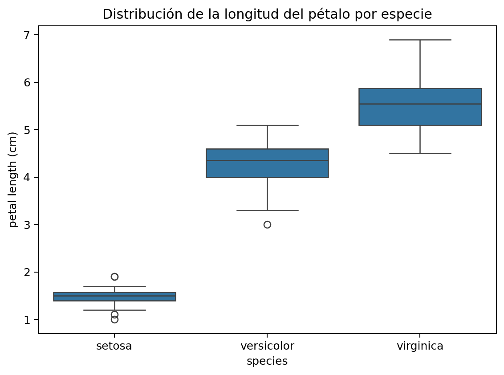
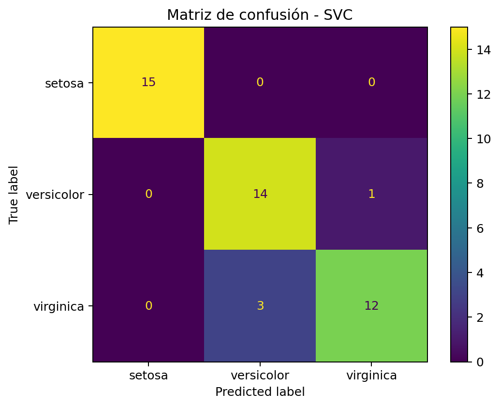
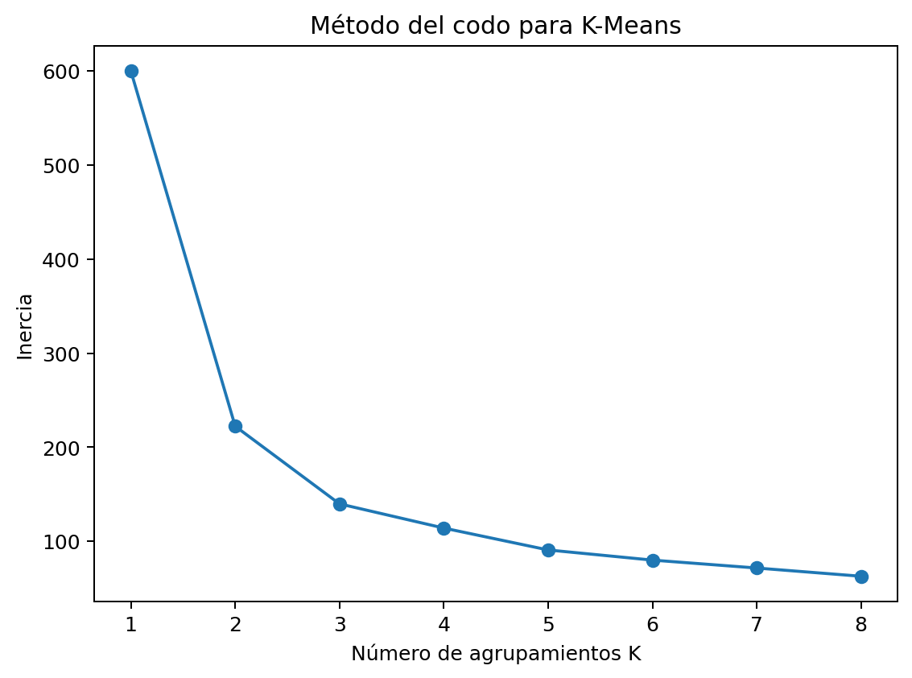
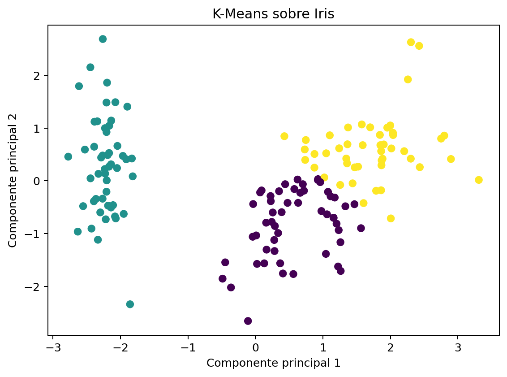

# Iris Machine Learning Analysis

**Exploratory Data Analysis · Supervised Classification · Unsupervised Clustering**

  

An academic Machine Learning project completed for **SEAS (Estudios Superiores Abiertos)** in September 2026, graded **10/10** for the mandatory assignment. It demonstrates a reproducible workflow, from exploring data to training, evaluating and interpreting supervised and unsupervised models.

## Dataset and research question

The built-in [Iris dataset](https://scikit-learn.org/stable/modules/generated/sklearn.datasets.load_iris.html) contains **150 labeled flower samples** (50 per species: setosa, versicolor, virginica), described by four numerical measurements: sepal length, sepal width, petal length and petal width.

**Questions:** How accurately can flower species be predicted from these measurements? Can unsupervised clustering recover a similar grouping without training on species labels?

## Methods

1. Load the Iris dataset and examine descriptive statistics using pandas.
2. Explore petal measurements with scatter and box plots (Seaborn/Matplotlib).
3. Split data into 70% training and 30% test sets, preserving class proportions.
4. Train a `StandardScaler → SVC(kernel="linear", C=1)` pipeline.
5. Evaluate predictions using a confusion matrix, classification report and 5-fold cross-validation.
6. Standardize features and apply `KMeans(n_clusters=3)`; assess clustering using silhouette score and the elbow method.
7. Project standardized observations onto two principal components (PCA) to visualize clusters.

## Results

| Experiment | Result | Interpretation |
| --- | ---: | --- |
| Linear SVM — held-out test accuracy | **91.11%** (41/45) | Four errors, all between versicolor and virginica |
| Linear SVM — 5-fold CV mean accuracy | **96.67%** | Average across five folds, not held-out test accuracy |
| K-Means (K=3) — silhouette coefficient | **≈ 0.460** | Moderate cluster separation |
| K-Means — post-hoc majority-label agreement | **83.33%** (125/150) | External comparison after training; **not** predictive test accuracy |

The Iris *setosa* species separates especially well; *versicolor* and *virginica* overlap more substantially.

## Visualizations

### Petal length vs. petal width


### Petal length distribution by species


### SVM confusion matrix


### K-Means elbow method


### PCA projection of K-Means clusters


## Run locally

```bash
python -m venv .venv
# Windows (PowerShell):
.venv\Scripts\Activate.ps1
# macOS / Linux:
# source .venv/bin/activate
pip install -r requirements.txt
python final_work.py
```

The script prints descriptive statistics and model evaluation results and displays five plots. The PNGs in `figures/` are pre-generated from the provided Python script.

## Limitations

- Iris is a small, balanced, curated academic dataset, not real operational data.
- Results from a single train/test split can vary; cross-validation offers additional context but does not guarantee production performance.
- K-Means cluster identifiers are arbitrary. The 83.33% figure comes from a post-hoc comparison to ground-truth labels and should not be interpreted as a supervised classifier's accuracy.
- Cluster separation is imperfect, particularly between versicolor and virginica; real deployment would require more representative data and additional validation.

## Files

- `final_work.py` — original Python implementation.
- `figures/` — five generated visualizations.
- `machine_learning_report.pdf` — full Spanish academic report, including methods, figures and conclusions.
- `requirements.txt` — Python dependencies.

**Author:** Oriol Chiva Hidalgo · [GitHub](https://github.com/Chivaa8) · [Portfolio](https://chivaa8.github.io/portafolios/#inicio)
